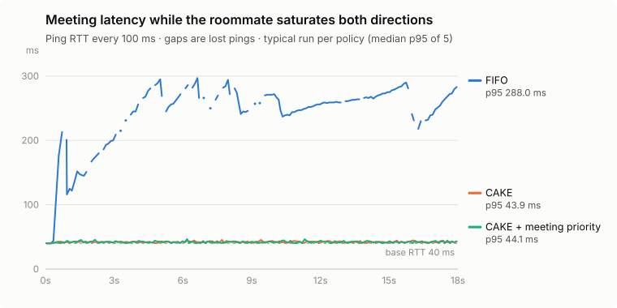
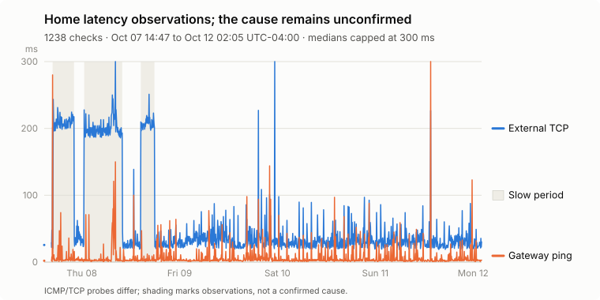

# RoomFlow

**Can my video call stay usable while my roommate uploads and downloads large files on the same connection?**

RoomFlow investigates it with real packets: a Linux lab that shares one bottleneck between a "meeting" device and a "roommate" device, then compares three queueing policies under the same bandwidth. A separate `homenet` tool records observations on a real home connection. Neither packet metrics nor service TCP probes establish actual video-call quality.

[中文說明](docs/README.zh-TW.md)

## Evidence to inspect

- **Controlled reference lab:** [raw packet results](results/native-ci/), [measurements CSV](results/native-ci/batch/measurements.csv), [separate raw-data audit](results/native-ci/batch-audit.json), and [CI workflow](.github/workflows/kernel-lab.yml).
- **Home investigation:** [incident case and runbook](docs/home-incident.md), with observations, competing explanations, and the next checks. The private SQLite history stays local; the case uses a fixed de-identified snapshot.
- **Home-inspired lab:** [35/250 Mbps profile results](results/native-ci-home/summary.md). These are controlled kernel measurements under chosen assumptions, not a measured improvement on a home router.
- **Historical evidence:** [QEMU packet measurements](results/linux/REPORT.md), [initial verification](TEST_REPORT.md), and [Node model results](results/model/REPORT.md) remain separate from the newer CI runs.

## Monitor saved observations and recovery

Run `npm start` and open `http://127.0.0.1:3210`. The homepage now offers **three simple usage preferences and an explicit lightweight connection check**. Preferences are saved in this browser only: **a home router is not connected, and no actual network policy is applied**. The check runs the existing Python probes on the computer hosting RoomFlow; it does not measure a different device that opens the page, run bulk traffic, or establish actual game/call quality. Python 3 must be available (`ROOMFLOW_PYTHON` can select its executable).

The **measurement and incident view** remains at `/monitor.html`: gateway/external latency, unsuccessful-probe ratios, a timestamped chart, and selectable incidents with observations, unknowns, and next checks. Historical, local, stale, and missing data remain labelled separately. The original model and saved kernel evidence are at `/lab.html`. See the [beginner homepage and check guide](docs/beginner-home.md).

- Three consecutive abnormal checks open an incident; two complete healthy checks confirm recovery. Missing observations and collection gaps never stand in for recovery.
- Event details include measured per-layer p95 peaks, thresholds, unsuccessful/attempted probe totals and healthy gateway comparisons. Select an event to focus its before/after chart; reset to full history at any time.
- Saved fault drills play one sample at a time through pending, open, recovering and resolved states. Each frame is computed by the same Python state machine and hides later observations/outcomes until that step.
- Each event retains affected layers, start/confirmation/recovery times and a bounded observed duration. Durable local opening/recovery records are deduplicated across restarts; no external messages are sent.
- Existing `homenet check` / `watch` collection updates the local aggregate export. Use `python -m homenet dashboard` to rebuild it from saved history without probing the network.
- Share or open the **[self-contained offline demonstration](artifacts/demo/RoomFlow.html)**. Its fixed historical data are de-identified; dates and evidence limits remain visible. Rebuild with `node scripts/build-observation-demo.mjs`.
- **[Isolated incident drills](docs/incident-drills.md)** exercise real delay, packet loss and DNS no-response, including event opening and measured recovery. Saved drill evidence is separate from home observations and the model.

See the [monitoring guide](docs/incident-monitoring.md) and [JSON contract](docs/observations-schema.md). Operational incidents use a stricter multi-layer rule than the earlier three external-latency episodes, so those counts are not interchangeable. Probe failures do not measure call-media packet loss.

## Finding in the controlled reference lab

Under the lab's saturated FIFO workload, queueing raised latency substantially. CAKE reduced it to near the configured base RTT with no observed meeting UDP loss. Device priority provided no meaningful additional RTT benefit in this reference workload. This does not diagnose the cause of the home slow periods below.

<picture>
  <source media="(prefers-color-scheme: dark)" srcset="docs/latency-dark.svg">
  
</picture>

Both directions congested (5 Mbps up / 20 Mbps down, 40 ms base RTT), five runs per policy on a native Linux kernel in CI ([workflow](.github/workflows/kernel-lab.yml), [raw results](results/native-ci/)):

| Policy | Meeting p95 RTT, mean (range) | Meeting loss up / down | Roommate throughput up / down |
|---|---:|---:|---:|
| FIFO (a plain router queue) | 288 ms (286–289) | 11.4% / 0.2% | 3.64 / 18.32 Mbps |
| CAKE SQM (fair queuing + AQM) | 43.9 ms (43.7–44.1) | 0% / 0% | 3.60 / 17.53 Mbps |
| CAKE + meeting priority | 44.2 ms (43.9–44.6) | 0% / 0% | 3.62 / 17.24 Mbps |

- **FIFO lets the bulk transfers fill the buffer**, so every meeting packet waits behind them: the 40 ms round trip becomes 288 ms at p95, and 11% of the meeting's upstream packets are lost.
- **CAKE keeps the queue short and shares the link fairly:** p95 is 4 ms above the base RTT with no meeting loss, and it costs the roommate about 4% of download throughput.
- **Meeting priority showed no additional RTT benefit here:** 44.2 vs 43.9 ms, overlapping ranges, no loss either way. Fair queuing and AQM already protected the meeting device under this workload; different traffic demands could produce different results.

The same pattern appears in each direction alone (upload: 232 ms FIFO vs 44 ms CAKE; download: 304 vs 41 ms), and with no background traffic all three policies sit at 40 ms. Each profile has 60 runs: four scenarios × three policies × five repeats. The full table is in each CI run's summary; a separate audit implementation recomputes the summaries from the raw files, and the self-test checks that a roommate forging the Voice DSCP mark gets no priority. An audit pass confirms data consistency, not an independent third-party review or a causal diagnosis.

**Why CI.** The historical QEMU TCG guest runs drifted, and even idle runs under CAKE showed loss. The later CI runner's native Linux kernel produced zero-loss idle runs and much tighter ranges. Changing execution environments did not isolate the cause of the original variation, so QEMU timing remains a hypothesis rather than a proven sole cause. The original runs are kept in [results/linux/](results/linux/REPORT.md) and the [first verification report](TEST_REPORT.md).

## How it works

```
meeting  10.77.1.2 ──┐               shared 5 Mbps up             netem, 20 ms each way
                     ├── router ─────────────────────── delay ─────────────────────── server
roommate 10.77.2.2 ──┘               shared 20 Mbps down
```

- **Topology:** five Linux network namespaces joined by veth pairs. Both users go through the same upload bottleneck (on the router's WAN side) and the same download bottleneck (on the far side, because Linux shapes traffic as it leaves an interface). The 40 ms round trip is added by netem on a separate link, so delay and queueing don't interfere. Offloads (GSO/GRO/TSO) are off so FIFO and CAKE see the same packets.
- **Policies:** FIFO is HTB with a plain FIFO queue (about 300 ms of buffer). SQM is CAKE in best-effort mode with per-host fairness. Meeting priority is CAKE diffserv4 with the meeting device classified into the Voice tin. Classification uses the device's source address and ingress interface, not the packet's DSCP mark, so a self-test checks that a roommate forging the Voice DSCP gets no priority. All three get the same bandwidth.
- **Traffic:** the meeting is a 600 Kbps UDP stream in each direction (a stand-in for call media) plus a timestamped ping; the roommate runs four TCP flows per direction with iperf3.
- **Measurement:** latency from the meeting's ping; loss, jitter, and throughput from iperf3's receiver-side reports; kernel qdisc and classifier counters before and after each run. 3-second warm-up, 15-second measurement, run order shuffled with a fixed seed, all raw files kept. A separate audit implementation recomputes the summaries from the raw files. Table RTT values are means of per-run p95 values, not pooled percentiles; ranges show the smallest and largest per-run p95.
- **Timed meeting mode:** `lab/session.py` applies priority for a set time, reads the kernel config back to confirm it, and a separate supervisor restores fair queuing when it expires, including after a restart.

The repository also has a browser dashboard and a Node.js queueing model for exploring the same question on Windows without a Linux kernel. The model is a simplified simulation, not CAKE; its numbers and the kernel lab's are not interchangeable.

## Home observations: what remains unconfirmed?

The lab compares queue policies under controlled congestion. [`homenet/`](homenet/) collects the evidence needed to investigate the earlier question: which observations coincide with a slow home connection, and what additional tests could distinguish Wi-Fi, queueing, upstream routing, DNS, or endpoint behavior? Its labels flag observations; they do not certify the root cause. See the [home incident case](docs/home-incident.md) for the fixed snapshot and investigation runbook.

<picture>
  <source media="(prefers-color-scheme: dark)" srcset="docs/home-latency-dark.svg">
  
</picture>

The [de-identified snapshot](docs/evidence/home-incident.json) ends at **2026-10-12 06:05:02 UTC**: 1,238 checks over about 107 h 18 min, with three detected slow periods totaling 17 h 55 min. Each check's external value is the mean of available targets' TCP p50 values; the baseline is the 10th percentile of that check series, 21.95 ms. The period values below are medians over retained slow checks within each period. Ongoing private collection can differ from this fixed snapshot:

- **Gateway observations were mixed:** gateway median RTTs within the three slow periods were 4 / 2 / 3 ms. Across the whole snapshot, however, 284/1,238 checks had gateway p95 above 30 ms and the largest per-check gateway median was 306 ms. The local path was not uniformly healthy; these measurements do not exclude Wi-Fi contention, intermittent loss, or device-specific issues.
- **External latency had sustained plateaus:** the three periods lasted 5 h 15 min, 9 h 20 min, and 3 h 20 min, with external medians about 208 / 196 / 207 ms. Early trace replies also showed increased RTT, but hop number and ICMP timing do not establish ISP ownership or locate the responsible queue. Historical trace labels are heuristic observations.
- **Queueing is one hypothesis:** high medians are compatible with sustained delay, including queueing. Device traffic, Wi-Fi, routing changes, upstream congestion, and endpoint behavior remain alternatives. All 80 capacity runs were outside detected slow periods: 77 successful downloads had a median of 276.45 Mbps and 80 successful uploads a median of 40.54 Mbps. Download rates use bytes received by the program; upload rates use client-counted bytes and do not confirm receiver goodput. Three failed downloads are missing measurements, not 0 Mbps. Available-capacity evidence has not tested saturation during a slow period.
- **IPv6 probe availability was associated with the periods:** 9/9 runs inside and 0/46 outside lacked a successful IPv6 measurement for at least one target where IPv4 worked. Within the periods, 18 target rows recorded unsuccessful IPv6 TCP probes and 27 recorded no obtained IPv6 address; the historical address result does not isolate DNS failure from absent AAAA data or another lookup condition. This does not prove that all IPv6 connectivity failed or that an application fell back to IPv4.

The home cause remains unconfirmed. The next checks are a wired-versus-Wi-Fi comparison, valid load/capacity measurements during a slow period, and controlled before/after router changes if an appropriate router and access are available. CAKE has not been applied or measured on this home router.

**Home-inspired lab scenario, not an observed home fix.** CI also runs a 35 Mbps up / 250 Mbps down, 25 ms base RTT profile. These values approximate earlier home measurements. Its FIFO queue is deliberately set to 180 ms, based on the observed latency increase under a queueing hypothesis ([results](results/native-ci-home/summary.md), five runs per cell, separately audited):

| Both directions busy | Meeting p95 RTT, mean (range) | Meeting loss up / down | Roommate throughput up / down |
|---|---:|---:|---:|
| FIFO (180 ms queue) | 196 ms (195–198) | 2.3% / 0.1% | 20.5 / 237.5 Mbps |
| CAKE SQM | 25.8 ms (25.8–25.9) | 0% / 0% | 26.6 / 227.6 Mbps |
| CAKE + meeting priority | 25.6 ms (25.6–25.6) | 0% / 0% | 26.6 / 226.8 Mbps |

- The FIFO row resembles the ~200 ms home plateaus because the queue was sized from them. This calibration is not evidence that the home delay was queueing. The CAKE row is a lab result, and a conditional prediction only if the real bottleneck and traffic behave similarly: **under one millisecond above the configured 25 ms**, with no observed meeting loss in these runs.
- In this profile, CAKE costs about 4% of download throughput and the roommate's upload rises from 20.5 to 26.6 Mbps. This is consistent with less contention between upload data and the download's TCP acknowledgments on the shared upload queue; the aggregate measurements do not isolate that mechanism.
- Meeting priority's 0.2 ms RTT difference does not establish a practically useful or statistically significant advantage.
- A router trial would require suitable hardware, correct shaper placement, and a rate below the usable bottleneck capacity. The lab puts CAKE directly at a known bottleneck; the home network may differ in location, rate variation, traffic, and CPU limits.
- The runner's CPU averaged above 85% in some runs of both profiles, idle runs included. CPU warnings cannot be attributed solely to link rate; the saved latency ranges remained narrow, without proving performance on a physical router.

- **`python -m homenet check`** reads Wi-Fi link facts, then probes the gateway, public IPs, DNS, and service TCP endpoints such as Zoom/Teams websites. It reports the lowest flagged observation as a troubleshooting starting point. A successful service TCP connection does not measure call media quality.
- **`python -m homenet bloat`** compares idle latency with latency while parallel transfers attempt to load the download and upload. It samples TCP handshakes to 1.1.1.1 five times a second and gateway ping once a second, and applies project-specific added-probe-latency grades only when the load succeeds. These grades do not predict call quality. The gateway comparison helps frame hypotheses; it does not uniquely localize a queue or rule out Wi-Fi.
- **`python -m homenet wifi`** scans nearby access points, groups 5 GHz channels into 80 MHz blocks, and reports advertised channel utilization. Matching likely same-router networks by address is a heuristic applied in memory; nearby AP counts and utilization do not directly measure available airtime or call quality. Quieter blocks are candidates for a controlled test, with DFS flagged.
- **`python -m homenet trace`** traces the route and pings replying hops in parallel. Its suffix-minimum RTT comparison is a heuristic: ICMP control-plane handling, asymmetric routes, and nonresponding hops limit localization. A second hop is only an early upstream observation; no carrier ownership follows from its position. Historical trace summaries describe the last replying hop, not a confirmed end-to-end RTT. Current destination labels require a successful literal-target match and reply.
- **`python -m homenet dns`** sends hand-built DNS queries (RFC 1035 wire format) straight to each resolver, including the system's own and public resolvers. It compares popular names with random names intended to reduce exact-name cache reuse; it does not verify that each query performs a full recursive lookup. Differences under 5 ms are reported as a tie.
- **`python -m homenet ipv6`** compares IPv4 and IPv6 TCP probes to the same named targets, reports address-lookup unavailability separately from unsuccessful TCP probes, and compares RTT only where both answer. It does not observe application address selection or fallback.
- **`python -m homenet capacity`** records download bytes received by the program and client-counted upload bytes over short transfer attempts, about 5 seconds each way; upload receiver goodput is not confirmed. Hourly samples can be compared with slow periods, but cannot identify another device or saturation cause on their own. Refused or timed-out transfers remain failed measurements with reasons (`HTTP 403 x4`), never 0 Mbps.
- **`python -m homenet watch`** repeats `check` in a terminal; **`report`** summarizes everything recorded. It starts with the slow periods: a check is slow when the internet latency is more than 50 ms above the line's normal (its 10th percentile), and a period runs from the first slow check to the last one before two normal checks in a row; a gap in the checks ends it as open-ended. Capacity and IPv6 runs are then split into inside and outside those periods. After that: latency by hour of day, each bufferbloat run, where the path adds latency across traces, and IPv4 vs IPv6 per service.
- **`scripts/schedule-homenet.ps1 install`** registers four unattended Windows tasks for the current user, only while logged on: `check` every 5 minutes, `path` every 2 hours, `capacity` hourly, and `bloat` three times a day. `check` skips the deliberate bloat load. Capacity and bloat use substantial data and can affect concurrent calls; choose their schedule accordingly. Runs have no console window and append output in blocks. `uninstall` removes the tasks.

History goes to a local SQLite file. Network names, MAC addresses, and router/path-hop addresses are excluded from the persisted history; privacy tests check this boundary. The CLI can display live route information, so raw terminal logs need separate review before sharing. The published incident case contains aggregate, de-identified observations.

## Run it

Kernel lab (an isolated Linux VM with root; Python standard library only):

```sh
sudo python3 lab/netlab.py check                 # verifies netns, HTB, CAKE, netem, flower support
sudo python3 lab/netlab.py setup
sudo python3 lab/netlab.py selftest --duration 8 --output results/linux/selftest
sudo python3 lab/netlab.py batch --duration 15 --repeats 3 --output results/linux/batch
sudo python3 lab/netlab.py teardown
```

Dashboard and model (Node.js 22+, no dependencies):

```sh
node src/server.mjs                # http://127.0.0.1:3210, English / 繁體中文
node --test tests/*.test.mjs
python3 -m unittest discover -s lab -p "test_*.py"
python3 -m unittest discover -s homenet/tests -t . -v
```

Details: [Linux lab guide](docs/linux-lab.md), [model definition](docs/simulator.md), [portable VM on Windows](docs/portable-vm.md).

## Limits

- Five 15-second runs per cell on one kind of CI runner: the differences that matter are far larger than the run-to-run spread, but this is not a statistical study across hardware.
- UDP at a fixed rate stands in for a call; there are no real codecs, adaptive bitrate, or Zoom/Teams quality scores.
- The policies are compared only in the lab. `homenet` measures one real home connection, but CAKE hasn't been tried on a real router there yet, so the home-speed numbers are a prediction.
- Home observations are sampled and observational: low gateway ping, early-hop RTT, and IPv6 probe failures do not by themselves identify a cause. The incident case records what remains untested.
