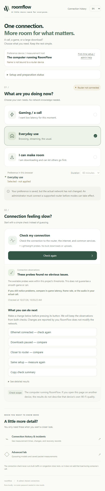

# RoomFlow 中文說明

[English README](../README.md)

把「室友大量傳檔時，我的會議連線能否更穩？」變成可重現、可量測的網路實驗。

執行 `npm start` 後，首頁提供三種簡單使用需求與一鍵輕量連線檢查。**模式目前只保存本瀏覽器的需求，尚未連接或控制家用路由器。** 真實檢查使用 Python 3，在執行 RoomFlow 的電腦進行，不做大量下載／上傳；結果不代表其他裝置的 Wi-Fi 或實際 LOL／會議品質。詳見[新手首頁說明](beginner-home.md)。

首頁的「連線紀錄」開啟本機歷史；`/monitor.html` 仍可選去識別化歷史與故障演練，`/lab.html` 保留原有模型與 Linux 封包實測介面。

專案包含三種清楚分開的證據來源：

- **Windows 可直接使用的模型介面**：封包事件、共用瓶頸、公平排隊與有限優先權由 Node.js 計算。這不是 Linux CAKE，也不會修改家裡的路由器。
- **Linux 實際封包 lab**：network namespaces、veth、tc、CAKE、netem、iperf3 與 ping，真實交換封包並留下核心佇列與接收端紀錄。這是虛擬拓樸的核心實測，仍不是實體 Wi-Fi 或 Zoom/Teams 品質驗證。
- **居家觀察工具 `homenet`**：在目前連線上量 Wi-Fi 狀態、gateway ping、公網與服務 TCP、DNS、IPv4／IPv6，以及負載時的延遲。它提供診斷起點與歷史紀錄，尚未確診慢時段原因，也沒有在家用路由器套用 CAKE。

## 先看畫面，再開始使用

<details>
  <summary><strong>展開首頁截圖：三種需求、一鍵檢查與調整後比較</strong></summary>
  <p></p>
  <p>這是 2026 年 10 月 27 日保存的英文介面截圖；右上角可切換繁體中文。圖中數字只代表當次檢查，不是你現在的網路狀況。</p>
</details>

### 安裝與開啟

需要 **Node.js 22 以上**；要執行真實連線檢查，還需要 **Python 3**。使用內建模組，不必執行 `npm install` 或 `pip install`。

```sh
git clone https://github.com/Lego514/roomflow.git
cd roomflow
npm start
```

用瀏覽器開啟終端顯示的網址，預設為 <http://127.0.0.1:3210>。使用期間保留終端，按 Ctrl+C 可停止。若找不到 Python，請參考[執行檔設定](beginner-home.md)。

**目前要在執行 RoomFlow 的電腦上使用。** 服務只開放本機；把 localhost 網址傳給室友或掃 Wi-Fi QR Code，都不會完成加入或啟用優先權。目前尚未提供路由器配對，也沒有經驗證的 Google／Nest Wifi 整合。

### 第一次使用，照這五步走

1. **選填電腦名稱：** 展開「第一次設定／管理者協助」，路由器資料可以之後補。名稱只是方便辨認，還不是已驗證的設備綁定；不用輸入路由器密碼。
2. **按「開始檢查」：** 輕量檢查這台電腦到路由器、外部網路、DNS 和服務的連線，不做大量下載或上傳。只開啟網頁不會自動開始檢查。
3. **先讀白話結果與建議：** 需要時展開數字。資料不足會保留未知；檢查成功也不能保證 LOL 或會議一定順暢。
4. **自己做一項調整，再量一次：** 例如先暫停下載，再按「已暫停下載」的比較按鈕；也能維持現況重測。系統記錄你表示的條件，不會代你變更或證實改動完成。需要分享時可複製摘要。
5. **到「連線紀錄與異常事件」看歷史：** 查看本機量測，或選有標示來源的歷史展示／故障演練。點事件可看觀察、尚未確定的事與下一步。剛安裝時沒有本機事件是正常的。

| 頁面 | 可以做什麼 |
|---|---|
| `/` | 選擇需求、保存設定準備資料、檢查連線與比較前後觀察 |
| `/monitor.html?source=local` | 查看本機量測、事件時間線與恢復紀錄 |
| `/lab.html` | 操作排隊模型、查看保存的 Linux 封包實測；與家用路由器控制分開 |

「打遊戲／開會」、「一般使用」、「我可以讓路」目前是**室友操作流程的預覽**。選擇與期限只保存在這個瀏覽器，到期恢復一般需求；實際網路沒有改變。完整儲存範圍與量測限制見[首頁使用說明](beginner-home.md)。

**不安裝也能看展示：** 下載[單檔離線展示](../artifacts/demo/RoomFlow.html)，再用瀏覽器開啟下載的 HTML。它包含保存的事件觀察與演練回放，不能執行新檢查或變更路由器；GitHub 的檔案預覽不會執行網站。

## 先看證據

- **受控 reference lab**：[CI workflow](../.github/workflows/kernel-lab.yml)、[原始封包資料](../results/native-ci/)、[量測 CSV](../results/native-ci/batch/measurements.csv) 與 [另寫的原始資料稽核](../results/native-ci/batch-audit.json)。
- **居家調查**：[incident case 與操作 runbook](home-incident.zh-TW.md)／[English case](home-incident.md)。公開的是固定、去識別化快照，SQLite 原始歷史留在本機。
- **參照早期居家觀察的固定 lab profile**：[35/250 Mbps 結果](../results/native-ci-home/summary.md)。這是指定條件下的核心實測，不是家用路由器實際改善量。
- **歷史資料**：[QEMU 封包矩陣](../results/linux/REPORT.md)、[初版驗證](../TEST_REPORT.md) 和 [Node 模型結果](../results/model/REPORT.md) 與新 CI 資料分開保存。

## 受控 reference lab 的結果

設定上下行共同壅塞、上傳 5 Mbps／下載 20 Mbps、基礎 RTT 40 ms；每策略重複五次。每個完整 profile 包含四情境 × 三策略 × 五次，共 60 次。以下 RTT 是各次 p95 的平均，括號為最小／最大單次 p95，不是合併後的百分位。

| 策略 | 會議 p95 RTT 平均（範圍） | 會議丟包上／下 | 室友吞吐量上／下 |
|---|---:|---:|---:|
| FIFO | 288 ms（286–289） | 11.4%／0.2% | 3.64／18.32 Mbps |
| CAKE SQM | 43.9 ms（43.7–44.1） | 0%／0% | 3.60／17.53 Mbps |
| CAKE＋會議優先 | 44.2 ms（43.9–44.6） | 0%／0% | 3.62／17.24 Mbps |

在這個負載中，FIFO 排隊使延遲大幅增加；CAKE 把延遲控制到接近基礎 RTT，未觀察到會議 UDP 丟包，室友下載吞吐量約少 4%。會議優先相對 SQM 沒有額外 RTT 優勢；這不代表所有流量與容量都會得到相同結果，也不證明實際視訊品質。

另寫的稽核工具從原始 ping、iperf3 receiver 與核心計數重算摘要。稽核通過代表資料一致性，不等同第三方審查或根因確認。Selftest 另驗證室友偽造 Voice DSCP 無法取得優先權。

**歷史 QEMU 與目前 CI：** 初版 QEMU TCG 的後段與 11 次補測有持續 RTT／丟包波動，包含 idle；原始資料完整保留。之後 GitHub Actions 的原生 Linux 核心量測得到零丟包 idle 與較窄的範圍。切換環境沒有單獨隔離原波動的原因，因此不能把 QEMU 計時當成唯一已證實根因。

## 居家觀察：哪些仍未確認？

[固定去識別化快照](evidence/home-incident.json) 截至 **2026-10-12 06:05:02 UTC**，約 107 小時 18 分鐘，包含 1,238 次檢查。每次公網數值是可用 target 的 TCP p50 平均；基準為該 check 序列的第 10 百分位數，21.95 ms。下列時段數值再取各時段保留的慢 check 中位數。偵測到三段高延遲，共 17 小時 55 分鐘；本機後續持續蒐集的資料可能不同。

- **Gateway 並非全程正常：** 三個慢時段內的 gateway RTT 中位數為 4／2／3 ms；但整個快照有 284／1,238 次檢查的 gateway p95 超過 30 ms，最高單次 gateway 中位數 306 ms。這些觀察不能排除 Wi-Fi 競爭、間歇性丟包或裝置問題。
- **公網延遲有持續平台：** 三段分別持續 5 小時 15 分、9 小時 20 分、3 小時 20 分，公網中位數約 208／196／207 ms。早期 trace 回應也有高 RTT；跳數與 ICMP 回應時間不能認定 ISP 所有權或定位造成延遲的佇列。
- **飽和／排隊假設未由同期容量證據支持：** 80 次容量量測都在慢時段外；77 次成功下載中位數 276.45 Mbps、80 次成功上傳中位數 40.54 Mbps。下載按程式收到的 bytes，上傳按 client 計數 bytes，未確認 upload receiver goodput。三次下載失敗是缺少量測，不能當成 0 Mbps。裝置傳輸、Wi-Fi、路由變動、上游壅塞或端點行為仍是候選原因。
- **IPv6 成功結果缺少與慢時段相關：** 慢時段內 9／9 次、時段外 0／46 次，至少一個 IPv4 可用目標缺少成功 IPv6 量測。慢時段內有 18 筆 IPv6 TCP 探測未成功、27 筆未取得 IPv6 位址；歷史記錄無法把後者區分成 DNS 故障、沒有 AAAA 或其他查詢情況。不能推論全網 IPv6 故障或應用程式已回退 IPv4。

居家根因尚未確認。下一步是有線／Wi-Fi 對照、慢時段內有效的負載與容量量測，以及確認設備與管理權限後的可回復路由器前後測。完整的假設、檢查順序與停止條件見 [incident case](home-incident.zh-TW.md)。

### 固定 home-inspired lab profile

CI 的另一個 profile 使用早期觀察近似值：上傳 35 Mbps／下載 250 Mbps、基礎 RTT 25 ms，FIFO 佇列故意設為 180 ms。這些是固定實驗參數；沒有改成新快照的容量中位數，也沒有在實體路由器實測。

| 上下行同時壅塞 | 會議 p95 RTT 平均（範圍） | 會議丟包上／下 | 室友吞吐量上／下 |
|---|---:|---:|---:|
| FIFO（180 ms 佇列） | 196 ms（195–198） | 2.3%／0.1% | 20.5／237.5 Mbps |
| CAKE SQM | 25.8 ms（25.8–25.9） | 0%／0% | 26.6／227.6 Mbps |
| CAKE＋會議優先 | 25.6 ms（25.6–25.6） | 0%／0% | 26.6／226.8 Mbps |

FIFO 類似居家約 200 ms 平台，是按該平台設定佇列得到的校準，不能據此確診居家 bufferbloat。CAKE 是 lab 量測結果；只有真實瓶頸與流量符合這些假設時，才可作為條件式預測。0.2 ms 的優先差異不證明實用或統計顯著優勢。實體設備還需正確 shaper 位置、低於可用瓶頸容量的設定、足夠 CPU 與可回復操作。

在此 profile，室友上傳 20.5 → 26.6 Mbps、下載約少 4%。上傳改善與 upload data／download TCP ACK 在共用上傳佇列的競爭減少相容；這些合計量測沒有單獨驗證該機制。兩個 profile 的部分 runs（包含 idle）都有 runner 平均 CPU 使用率超過 85%，不能只歸因於較高頻寬；已保存 RTT 範圍窄，也不是實體路由器效能保證。

## 居家工具與使用界線

| 指令 | 能提供的觀察 |
|---|---|
| `python -m homenet check` | Wi-Fi 事實、gateway、公網、DNS 與服務 TCP；標示最低一層異常觀察作為起點，不確診原因。Zoom／Teams 網站 TCP 成功不代表通話品質。 |
| `python -m homenet bloat` | 閒置與有效上下行負載的新增 probe 延遲，按本專案門檻分級；負載失敗不給等級，等級不預測通話品質。Gateway 對照不能唯一定位佇列或排除 Wi-Fi。 |
| `python -m homenet wifi` | 鄰近 AP、80 MHz 區塊與廣播使用率；同路由器匹配是記憶體中的推測法。安靜頻道只是對照測試候選。 |
| `python -m homenet trace` | 回應 hop 的 ICMP 比較；suffix-minimum 是 heuristic，受控制平面、不對稱路徑與缺少回應限制。第二跳不代表已知 ISP；歷史最後回應 hop 不等於終點 RTT。 |
| `python -m homenet dns` | 直接送 DNS wire-format 查詢，比較熱門與隨機名稱；隨機名稱用來降低相同名稱快取重用，未驗證每次完整 recursive lookup。小於 5 ms 的差異列為平手。 |
| `python -m homenet ipv6` | 同目標 IPv4／IPv6 TCP 對照，區分未取得位址與 TCP 探測未成功；僅兩邊成功時比較 RTT，不觀察 app fallback。 |
| `python -m homenet capacity` | 短時下載按程式收到的 bytes，上傳按 client bytes，未確認 receiver goodput；可與慢時段比對，不能單獨辨識其他裝置或飽和原因。拒絕／逾時留缺值。 |
| `python -m homenet watch`／`report` | 定時檢查、慢時段事件、容量與 IPv6 時間對齊，保留抽樣與相關性的限制。 |

`scripts/schedule-homenet.ps1 install` 建立四個 Windows 排程：check 每 5 分鐘、path 每 2 小時、capacity 每小時、bloat 每天三次；只在目前使用者登入時執行。Check 會跳過刻意 bloat 負載。Capacity 與 bloat 會大量傳輸並影響同期會議，應安排合適時段。`status` 可看狀態，`uninstall` 移除工作。

SQLite 歷史不保存 SSID、MAC、gateway 或路徑 hop 位址；隱私測試檢查此界線。CLI 可即時顯示路由資訊，分享終端 log 前仍需另外去識別化。

## 進階實驗介面

完成上方安裝並啟動後，從首頁進入「進階實驗室」，或直接開啟 <http://127.0.0.1:3210/lab.html>。以下步驟操作的是排隊模型與保存證據。


右上角可切換「繁體中文／English」，會保存這台瀏覽器的選擇。切換時保留目前的倒數、輸入條件與已顯示報告；原始 JSON／CSV 欄位和數值不隨語言改變。

1. 選擇「室友正在上傳、下載或同時傳輸」與頻寬。
2. 執行三策略對照，等待實驗完成。
3. 比較延遲、抖動、丟包及室友吞吐量；下載 CSV 或完整 JSON。
4. 使用「10 秒自動恢復測試」驗證計時模式。伺服器讀回設定後才顯示成功，到期回到公平排隊。
5. 下方「保存的 Linux 封包實測」可切換四種負載，查看已保存的三次重複量測及下載 CSV。這份實測不會隨 Web 計時卡片重新執行。

計時卡片中的「目前策略快照」會按照目前策略重新計算一個固定混合負載模型。它不是即時網路量測。完整對照實驗永遠固定比較 FIFO、公平排隊與優先排隊，不會被計時卡片改變。

狀態與實驗紀錄保存在 `data/`；到期時間會持久化，服務重啟後會重新套用有效策略或恢復已到期的策略。中途被服務重啟打斷的實驗會標記失敗，完成的報告仍可讀取。

## 驗證與重現

```powershell
node --test tests/*.test.mjs
node scripts/run-matrix.mjs
python -m unittest discover -s homenet/tests -t . -v
```

矩陣包含四個負載情境、三個策略、三次不同啟動相位，共 36 次模型實驗。原始封包時間戳、探測、守恆計數與樣本保存在 `results/model/*.json.gz`。摘要為每次實驗指標的平均；p95 欄位是各次 p95 的平均，不是合併後的 p95。

Linux 的純 Python 回歸測試：

```sh
python3 -m unittest discover -s lab -p 'test_*.py' -v
```

真正的 Linux lab 需要在可處理核心網路功能的隔離 Linux 環境以 root 執行。GitHub Actions workflow 已先執行 Node／Python／homenet 回歸測試，再執行兩個 kernel profile、自我測試、矩陣、清理、資料稽核及 artifact 保存：

```sh
sudo python3 lab/netlab.py check
sudo python3 lab/netlab.py setup
sudo python3 lab/netlab.py selftest --duration 8 --output results/linux/selftest
sudo python3 lab/netlab.py batch --duration 15 --repeats 3 --output results/linux/batch
sudo python3 lab/netlab.py teardown
```

實際 Linux 限時控制另有 `lab/session.py start --seconds 60`、`status` 與 `stop`。它會變更隔離拓樸內的實際 qdisc，到期由獨立監督程序恢復原策略。Web 介面的計時示範與 Linux 控制器互相獨立。

## 事件監控與恢復紀錄

執行 `npm start` 後，從首頁進入「連線紀錄與異常事件」，或開啟 <http://127.0.0.1:3210/monitor.html>。紀錄頁可切換去識別化歷史展示、本機量測與隔離演練結果，查看 gateway／外部延遲、探測未成功比例、事件時間線與排查建議。歷史和過期資料有明確日期，不會顯示成即時健康。

- 連續三次異常才開案，連續兩次完整正常才結案；沒有資料或收集中斷不等於修復。
- 事件詳情列出四層實測峰值、門檻、失敗／嘗試次數及同期正常對照；點事件可聚焦前後圖表，再切回完整歷史。
- 隔離演練可逐筆播放「正常→待確認→開案→恢復中→已結案」；每一步沿用Python狀態機，不提前顯示後面的數字或恢復結果。
- 記錄開始／確認／恢復時間、異常層與觀察時長；本機開案和恢復紀錄跨重啟去重，不傳外部通知。
- `homenet check`／`watch` 會更新本機匯出；`python -m homenet dashboard` 只用既有歷史重建，不主動測速。
- 可直接開啟並分享 [單檔離線展示](../artifacts/demo/RoomFlow.html)，不需要伺服器或連網；資料與來源註記已嵌入。
- [隔離 Linux 演練](incident-drills.md) 用實際封包製造延遲、丟包和 DNS 無回應，再驗證開案與恢復。演練結果、家用觀察和原有模型分開標示。

詳見 [事件監控使用說明](incident-monitoring.md) 與 [JSON 格式](observations-schema.md)。新事件規則與舊案例的三個慢時段不同，不能直接比較事件數；探測失敗也不等於視訊媒體丟包率。

## 結果與設計文件

- [目前 CI workflow](../.github/workflows/kernel-lab.yml)／[reference 資料](../results/native-ci/)／[固定 home profile](../results/native-ci-home/summary.md)
- [居家 incident case](home-incident.zh-TW.md)／[English](home-incident.md)／[去識別化快照](evidence/home-incident.json)
- [歷史初版完整驗證報告](../TEST_REPORT.md)
- [中英介面檢查](BILINGUAL_QA.md)
- [模型實驗數據](../results/model/REPORT.md)／[資料核對](../results/model/AUDIT.md)
- [歷史 QEMU Linux 封包結果](../results/linux/REPORT.md)／[原始資料稽核](../results/linux/BATCH_AUDIT.md)
- [模型的假設與量測定義](simulator.md)
- [Linux lab 的拓樸、前置條件與操作方式](linux-lab.md)
- [這台 Windows 的可攜 VM 重現方式](portable-vm.md)

歷史 QEMU 在 `results/linux/`、目前 reference CI 在 `results/native-ci/`、固定 home CI 在 `results/native-ci-home/`，與 `results/model/` 分開。Web 下方保存實測卡片仍展示歷史 QEMU 資料，不隨 Web 計時器或新的 CI 矩陣變更。`artifacts/screenshots/` 保留操作畫面。

## 適用範圍

UDP 流量是會議傳輸的替代負載，沒有模擬完整 WebRTC 編碼、自適應碼率或影音體感。對照重點是排程與壅塞，不包含 Wi-Fi 訊號弱、ISP 斷線或服務端故障。

每格五次、每次 15 秒、單一類型 CI runner 的結果不構成跨硬體統計研究。公平排隊在已測負載可能已足夠；優先模式的額外價值要依證據判斷。每個結果保留室友吞吐量。居家資料為抽樣觀察，尚未確認根因；仍需真實 router adapter、可回復前後測與實際通話驗證。
